<p align="center">
  <picture>
    <source media="(prefers-color-scheme: dark)" srcset="crates/shellmate/assets/app-icon/dock-dark.png">
    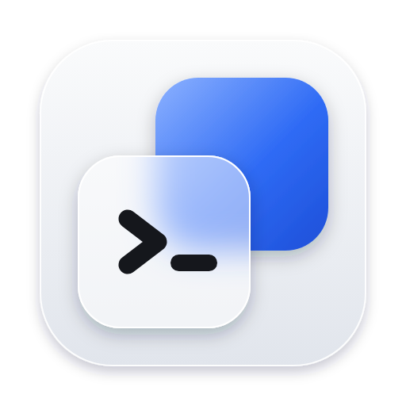
  </picture>
</p>

<h1 align="center">Shellmate</h1>

<p align="center">
  一款为 macOS 打造的原生 SSH 客户端：终端、文件、端口转发、服务器监控和 AI 助手集中在一个窗口里。<br>
  基于 Rust 与 <a href="https://github.com/zed-industries/zed/tree/main/crates/gpui">GPUI</a> 编写，完全原生渲染，不依赖 WebView。
</p>

<picture>
  <source media="(prefers-color-scheme: dark)" srcset="docs/images/hero-dark.png">
  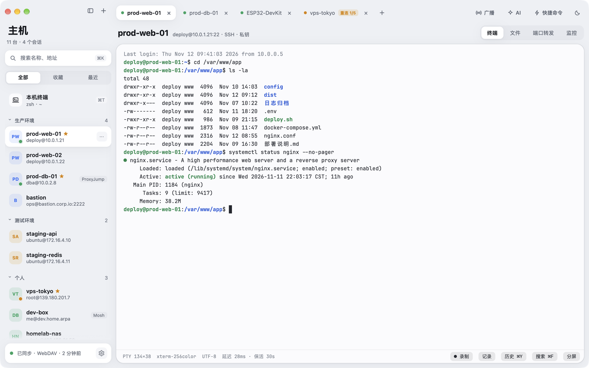
</picture>

> 文中截图均使用内置的演示数据，主机名、地址和输出都是虚构的。

## 目录

- [功能一览](#功能一览)
- [安装](#安装)
- [快速上手](#快速上手)
- [功能详解](#功能详解)
- [键盘快捷键](#键盘快捷键)
- [数据与隐私](#数据与隐私)
- [从源码构建](#从源码构建)
- [开发](#开发)
- [许可证](#许可证)

## 功能一览

| 方面 | 内容 |
|---|---|
| 连接 | SSH、Mosh、Telnet、串口、本机终端；ProxyJump 跳板机；密码、私钥、ssh-agent、键盘交互（含双因素验证码） |
| 终端 | 基于 alacritty_terminal 的真彩终端；中文宽字符；滚动缓冲搜索；括号粘贴；选中即复制；分屏 |
| 主机管理 | 分组、收藏、最近使用；从 `~/.ssh/config` 导入；主机指纹校验 |
| 凭据 | 存入 macOS 钥匙串，或主密码加密的本地库（Argon2id + XChaCha20-Poly1305），支持 Touch ID 解锁与闲置自动锁定 |
| 文件 | SFTP 浏览、上传下载队列（可续传）、拖拽、内置文本编辑器（冲突检测、原子保存）、跟随终端目录 |
| 端口转发 | 本地 / 远程 / 动态（SOCKS5）转发规则，按主机保存，随连接自动启动 |
| 监控 | Linux 服务器免安装监控：概览、进程、systemd 服务、Docker / Podman；本机 macOS：概览、进程、监听端口、launchd 服务、Docker |
| 效率 | 命令面板（含 `user@host` 快速连接）、快捷命令、广播输入、跨主机命令历史、危险命令发送确认 |
| 会话记录 | 录制回放（asciicast v2，可导出 `.cast`）与纯文本会话日志 |
| AI 助手 | OpenAI 兼容接口与 Anthropic；读取当前终端上下文、解释报错、按审批规则在终端或后台执行命令；敏感信息自动脱敏 |
| 备份 | 加密配置包导出与导入（含导入前差异预览） |
| 更新 | 应用内检查、下载并安装新版本；校验安装包的 SHA-256 与代码签名 |

## 安装

**系统要求**：macOS 13 及以上，Apple 芯片或 Intel 处理器。

1. 从 [Releases](https://github.com/rermrf/shellmate/releases) 下载对应的安装包，打开后把 Shellmate 拖进「应用程序」：
   - Apple 芯片（M1 及以后）：`Shellmate-<版本>-arm64.dmg`，体积更小；
   - Intel 处理器：`Shellmate-<版本>-universal.dmg`，同时包含 Apple 芯片与 Intel 两种架构。
2. 安装包目前是临时签名（ad-hoc），没有经过 Apple 公证，第一次打开时 macOS 会提示无法验证开发者：
   - macOS 15 及以上：打开「系统设置 → 隐私与安全性」，在页面下方找到 Shellmate，点「仍要打开」并确认；
   - macOS 13 / 14：在「应用程序」里**右键 Shellmate → 打开**，在弹出的对话框中再点「打开」；
   - 若提示「已损坏，无法打开」，在终端执行下面这行后再打开：
     ```sh
     xattr -dr com.apple.quarantine /Applications/Shellmate.app
     ```

   dmg 里也附带了一份「首次打开说明」。
3. 之后的版本可以在应用内更新：Shellmate 启动后和每天会自动检查一次（可在「设置 › 软件更新」关闭），也可以在菜单「Shellmate › 检查更新…」手动检查。有新版本时，标签栏右侧会出现提示，点开即可下载并重启更新。

使用 Mosh 需要本机安装 `mosh-client`（例如 `brew install mosh`），远端安装 `mosh-server`。

## 快速上手

1. **添加主机**：点侧边栏的「新建主机」（⌘N），或「从 ~/.ssh/config 导入」。
2. **连接**：双击主机，或在命令面板（⌘K）里搜主机名；也可以直接输入 `user@host:port` 快速连接，不写入主机列表。
3. **切换面板**：每个 SSH 会话右上角都有「终端 / 文件 / 端口转发 / 监控」四个面板（⌥⌘1–4）。
4. **本机终端**：⌘T 打开。本机会话同样有文件和监控面板。
5. **从访达进入**：在访达的文件夹或空白处右键，选择「进入 Shellmate」，会在该目录打开本机终端；把文件夹拖到 Shellmate 图标上也一样。第一次使用前，需要在「设置 › 本地终端 › 访达右键菜单」点「在系统设置中打开」，启用 Shellmate 的访达扩展。

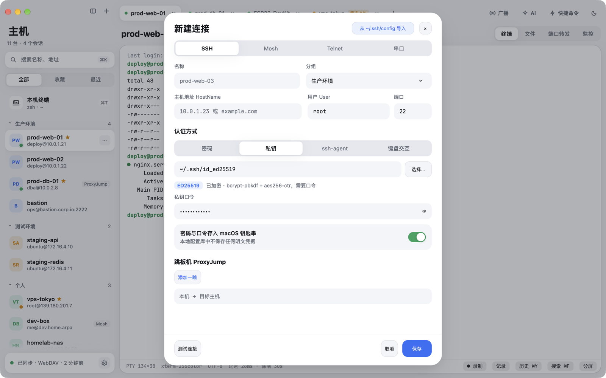

## 功能详解

### 终端与会话

- 多标签会话，标签过多时自动收进「N 个会话」菜单；⌘1–⌘9 直接切换。
- 分屏（⌘D）同时查看两个会话，输入焦点清晰标出。
- 断线自动重连，状态显示在标签上；重连后自动恢复文件会话和端口转发。
- 终端内搜索（⌘F / ⌘G / ⇧⌘G）、提示符高亮、括号粘贴、右键粘贴等，可在「设置 › 终端」调整。
- ⌃R 始终交给 shell 自己的反向搜索；应用的跨主机命令历史用 ⌘Y 打开。

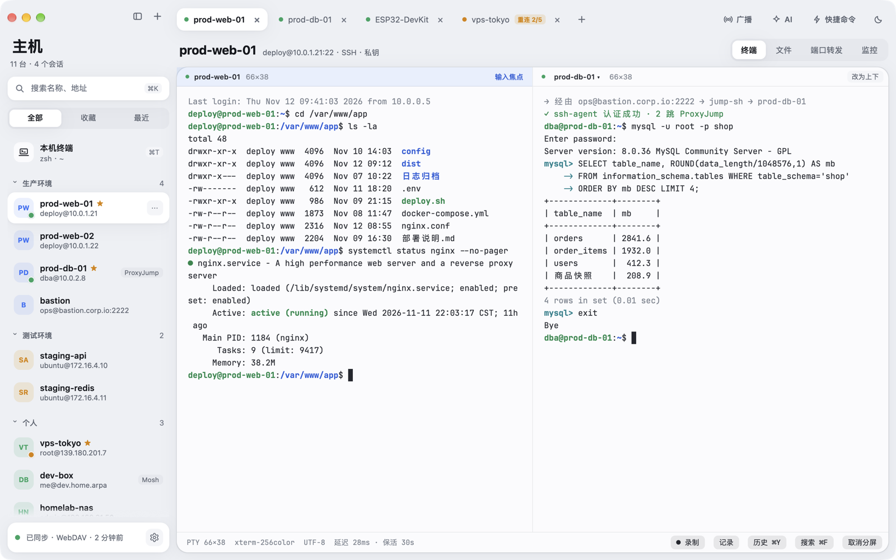

### 主机与凭据

- 主机支持分组、收藏、最近使用和搜索；连接方式包括 SSH、Mosh、Telnet、串口（可选波特率、十六进制视图）。
- SSH 认证支持密码、私钥（含口令）、ssh-agent、键盘交互；可配置多级 ProxyJump。
- 首次连接与指纹变化时会提示核对主机指纹。
- 凭据存储可在「设置 › 凭据与安全」二选一：
  - **系统钥匙串**：交给 macOS 管理，随登录解锁；
  - **主密码加密本地库**：Argon2id 派生密钥 + XChaCha20-Poly1305 加密，可用 Touch ID 解锁、闲置 15 分钟自动锁定，Shellmate 菜单里可以「锁定凭据库」。

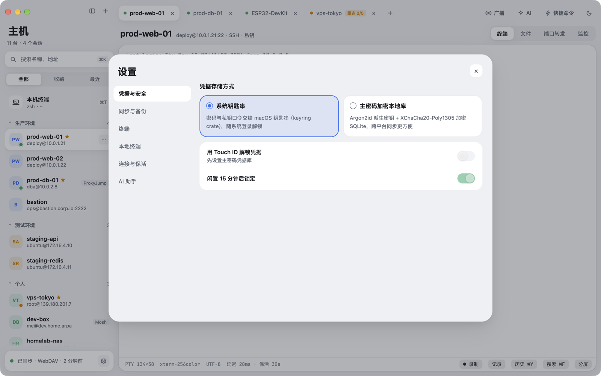

### 文件

- SFTP 浏览远端目录，目录在前、自然排序，显示大小、时间、权限和属主；可修改权限（chmod）。
- 上传 / 下载队列：拖拽即可上传，支持续传、冲突处理（替换 / 保留两者 / 跳过）。
- 内置文本编辑器：打开远端文本文件直接修改，保存时检测外部修改并原子替换，保留权限和换行风格。
- 「跟随终端目录」：终端里 `cd` 之后，文件面板自动跳到同一目录。
- SSH 连接后会在后台预先列出起始目录，高延迟主机上打开文件面板也无需等待（可在「设置 › 连接与保活」关闭）。
- 本机会话的文件面板：删除会移到废纸篓；从 Finder 拖入即复制；可「在 Finder 中显示」「用默认应用打开」。

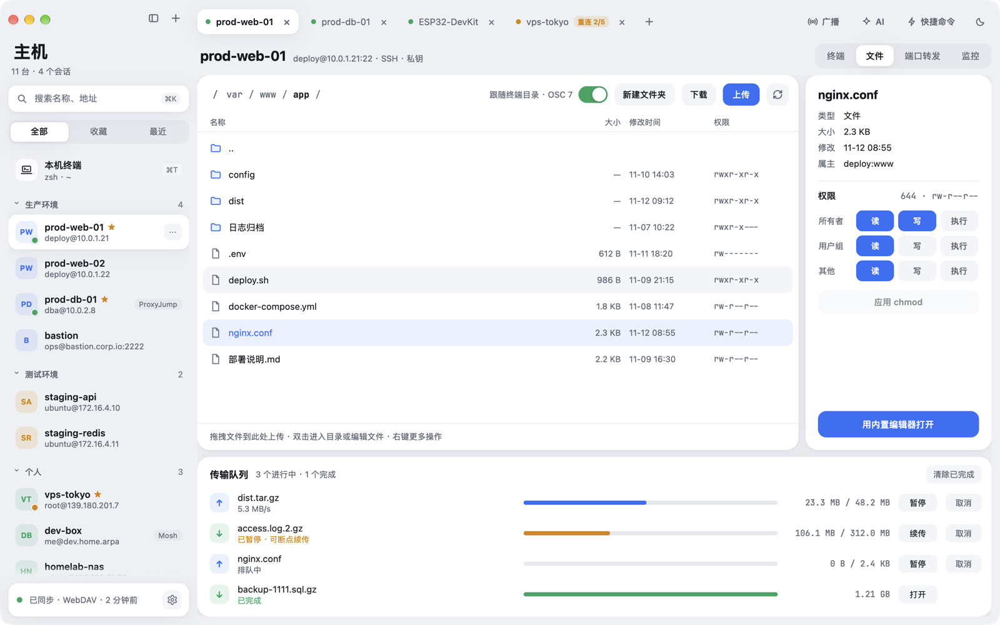

### 端口转发

- 支持本地转发（L）、远程转发（R）和动态转发（D，SOCKS5）。
- 规则按主机保存，可设为随连接自动启动，实时显示连接数和流量；端口冲突会给出明确提示。

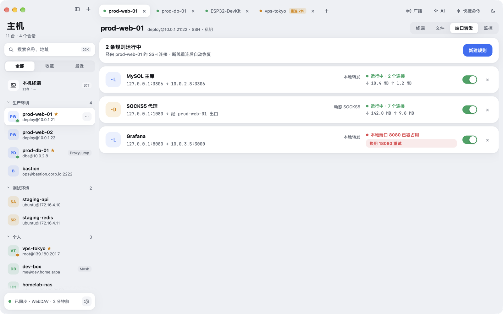

### 监控

远程 Linux 服务器**无需安装任何代理**：Shellmate 通过 SSH 执行一段只读脚本采集 `/proc` 与 `/sys` 数据。持续采集只在你打开监控页时进行；连接后只做一次轻量探测，让监控页打开时不用等待。

- **概览**：CPU（含各核）、内存、磁盘、网络、负载与「需要关注」的问题汇总。
- **进程**：按 CPU / 内存 / PID 排序、树形视图、发送信号、降低优先级；需要 sudo 的操作会把命令填进终端，由你输入密码。
- **服务**：systemd 服务列表、启动 / 停止 / 重启 / 重载、开机自启开关、跟随日志、失败原因。
- **Docker**：容器列表、资源占用、日志、启停与清理，支持 Docker 与 Podman。

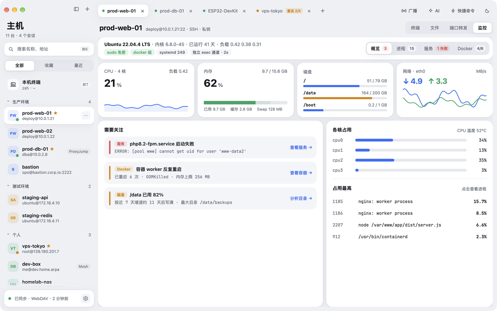

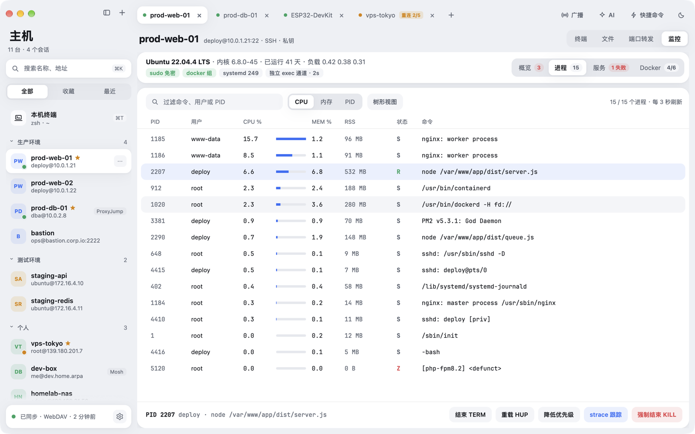

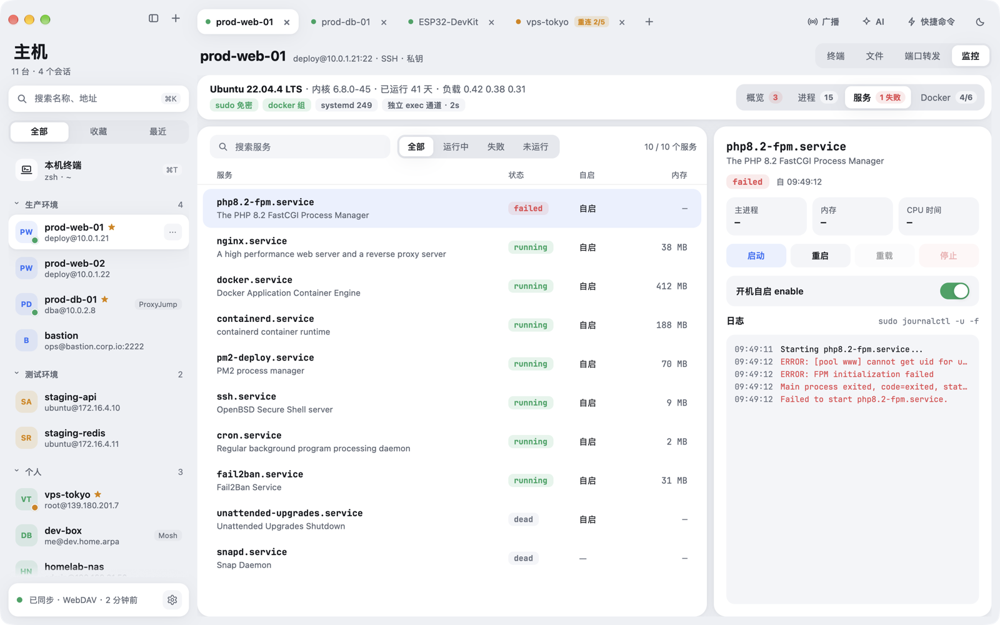

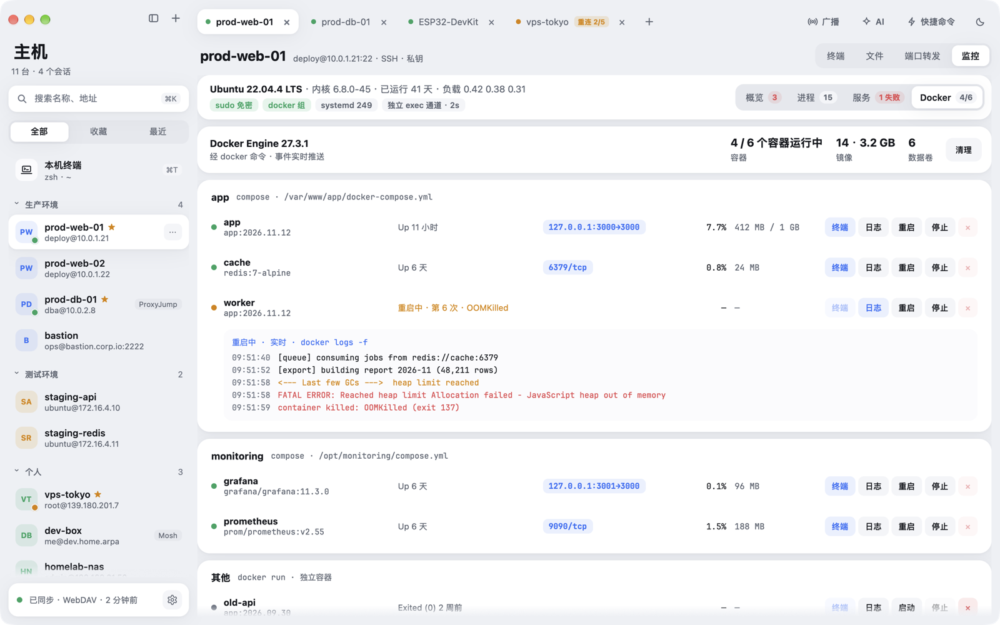

本机终端的监控用 macOS 原生接口采集，提供概览、进程、**监听端口**、**launchd 服务**（Homebrew 服务优先显示）和 Docker。

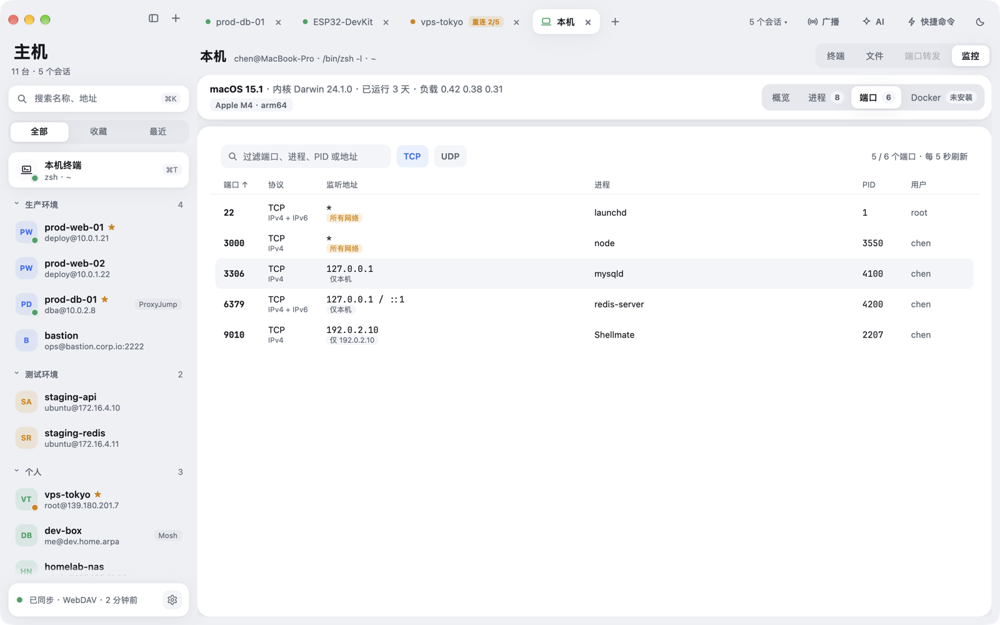

### 效率工具

- **命令面板**（⌘K）：切换会话、搜索主机、执行快捷命令和应用操作，输入 `user@host` 快速连接。
- **快捷命令**：按分组整理常用命令，一键发送到当前会话；危险命令发送前会二次确认。
- **广播输入**：勾选多个会话，一条命令同时发送。
- **命令历史**（⌘Y）：跨主机检索执行过的命令，可在设置里关闭记录或清空。

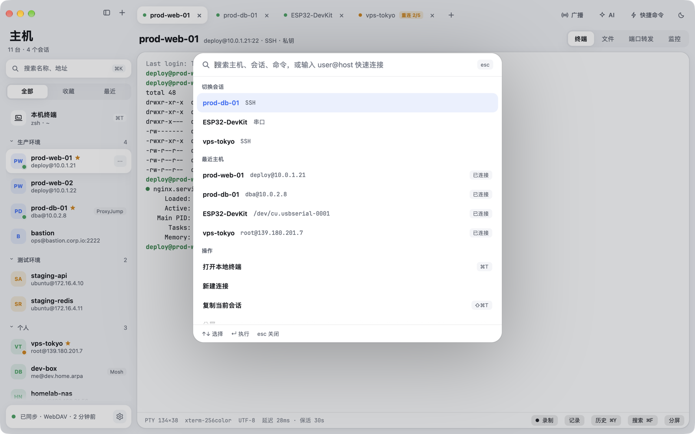

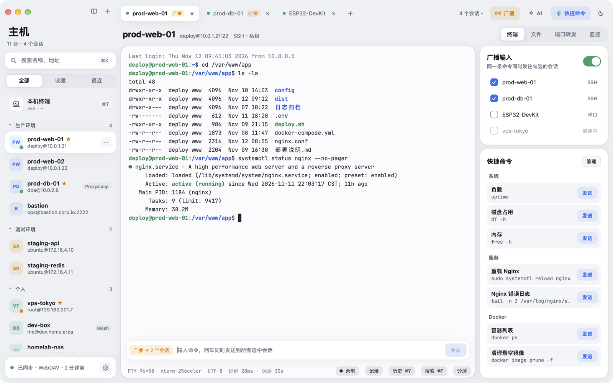

### 会话记录

- 录制会话并回放，支持倍速、拖动进度、显示时间轴，导出为 asciicast v2（`.cast`）。
- 可开启纯文本会话日志，按主机与日期归档。

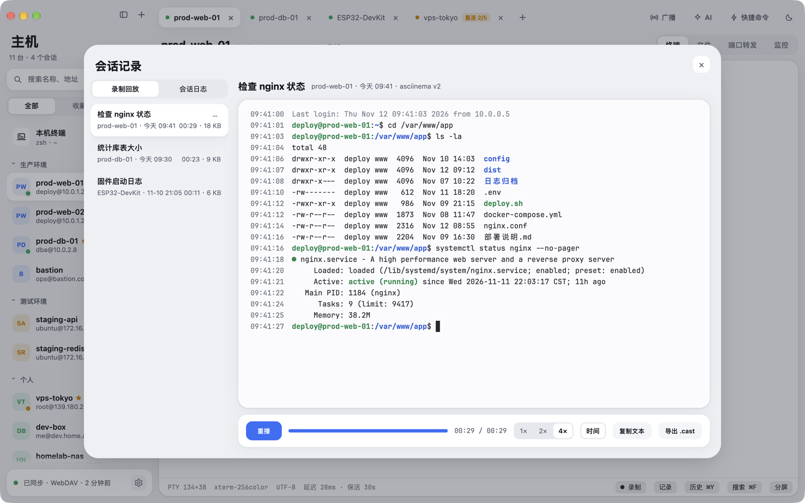

### AI 助手

- 支持 OpenAI 兼容接口（可自定义 Base URL）与 Anthropic，可选思考等级。
- 自动带上当前会话的最近终端输出作为上下文；终端出现报错时可以一键「解释报错」。
- 可以在终端里或后台执行命令（远程会话通过 SSH，本机会话在本机），三档权限：
  - **每步审批**：每条命令都需要你确认；
  - **自动审批**：只读命令直接执行，其余需要确认；
  - **完全访问**：直接执行。
  危险命令（如 `rm -rf`、`sudo`）在任何档位下都会单独标红并要求确认。
- 发送前自动去除密码、令牌、私钥等敏感内容；对话只保存在本机，可在设置中关闭保存。

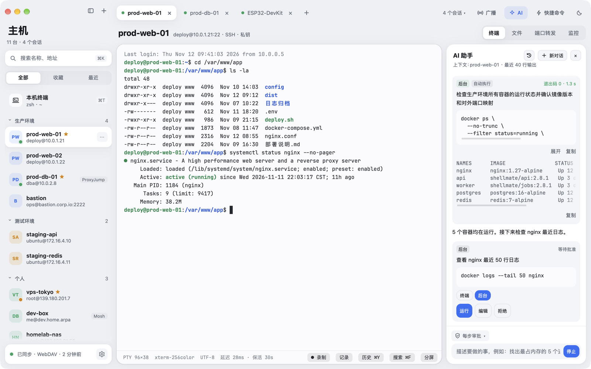

## 键盘快捷键

| 快捷键 | 操作 |
|---|---|
| ⌘T | 新建本机终端 |
| ⌘N | 新建连接 |
| ⇧⌘T | 复制当前会话 |
| ⌘W | 关闭会话 |
| ⌘1 … ⌘9 | 切到第 N 个会话（⌘9 为最后一个） |
| ⇧⌘[ / ⇧⌘] | 上一个 / 下一个会话 |
| ⌘D | 分屏 |
| ⌥⌘1 … ⌥⌘4 | 终端 / 文件 / 端口转发 / 监控 |
| ⌘K | 命令面板 |
| ⌘Y | 命令历史 |
| ⌘F / ⌘G / ⇧⌘G | 终端内查找 / 下一个 / 上一个 |
| ⌃⌘S | 显示 / 隐藏侧边栏 |
| ⌘, | 设置 |
| ⌃⌘F | 进入全屏幕 |

## 数据与隐私

| 内容 | 位置 |
|---|---|
| 主机、设置、命令历史、AI 对话 | `~/Library/Application Support/Shellmate/shellmate.db` |
| 会话录制 | `~/Library/Application Support/Shellmate/recordings/` |
| 会话日志与运行日志 | `~/Library/Logs/Shellmate/` |
| 密码与私钥口令 | macOS 钥匙串，或主密码加密的本地库 |

- 主机库中不保存任何明文凭据。
- Shellmate 不收集遥测数据。只有你主动向 AI 助手提问时，才会把问题和（脱敏后的）终端上下文发送到你配置的 AI 服务。
- 检查更新只访问 GitHub 的发布接口（`api.github.com`），请求中只带应用版本号；关闭「自动检查更新」后，只在你手动检查时访问。
- 加密配置包可用于在设备之间迁移主机、分组、快捷命令、端口转发规则，以及（可选的）凭据；导入前会显示差异预览。

## 从源码构建

需要：macOS 13+、Xcode 命令行工具、最新稳定版 Rust（项目使用 Rust 2024 edition）。

```sh
# 调试运行
cargo run -p shellmate

# 生成本机架构的 Shellmate.app 与 dmg
scripts/bundle-macos.sh release
# 输出：target/release/Shellmate.app、target/release/Shellmate-<版本>-arm64.dmg

# 发布用的两个版本（最低 macOS 13）
rustup target add aarch64-apple-darwin x86_64-apple-darwin
scripts/bundle-macos.sh release --universal   # Apple 芯片 + Intel 通用版
# 输出：target/release/Shellmate-<版本>-universal.dmg
scripts/bundle-macos.sh release --arm64       # 仅 Apple 芯片，复用上一步编好的 arm64 部分
# 输出：target/release/Shellmate-<版本>-arm64.dmg
```

签名：钥匙串里有项目的自签名证书「Shellmate Code Signing」时自动用它签名，否则使用临时签名；也可以用 `SIGN_IDENTITY` 指定签名身份。证书的生成、备份、GitHub 配置与更换见 [`docs/signing.md`](docs/signing.md)。

## 开发

### 目录结构

| crate | 作用 |
|---|---|
| `shellmate` | 应用本体：窗口、面板、对话框、菜单（GPUI） |
| `shellmate-core` | 公共类型：主机、协议、认证方式等 |
| `shellmate-term` | 终端仿真与视图（alacritty_terminal）、PTY、录制与日志 |
| `shellmate-ssh` | SSH 连接、认证、主机指纹、exec / subsystem 通道、ProxyJump、Mosh 引导 |
| `shellmate-sftp` | SFTP 会话、目录缓存、传输队列、远程文本读写 |
| `shellmate-forward` | 端口转发引擎 |
| `shellmate-monitor` | 远程 Linux 采集脚本与解析、macOS 本机采样、服务与 Docker |
| `shellmate-store` | SQLite 存储、凭据存储协调、加密配置包 |
| `shellmate-vault` | 主密码库加密与 Touch ID |
| `shellmate-ai` | AI 客户端、代理循环、命令风险分级、脱敏 |
| `shellmate-telnet` / `shellmate-serial` | Telnet 与串口连接 |

`vendor/russh` 是随仓库提供的 russh 副本，作为依赖编译，不参与工作区的检查与测试。

### 测试与检查

```sh
cargo test --workspace
cargo clippy --workspace --all-targets
```

需要真实 OpenSSH 服务器的端到端测试默认忽略（`#[ignore]`），运行方式和所需环境变量见各 crate `tests/` 下的模块说明，例如：

```sh
SHELLMATE_E2E_KEY=/path/to/key cargo test -p shellmate-sftp --test sftp e2e -- --ignored
```

`crates/shellmate-monitor/tests/latency` 提供了带人为延迟的首次打开耗时基准（同样默认忽略）。

### 持续集成与发版

- `.github/workflows/ci.yml`：推送到 `main` 和提交 PR 时，在 macOS 上运行 clippy（警告视为错误）与全部测试，并编译访达扩展（Swift，位于 `macos/FinderExtension`，不在 cargo 工作区内，由 `scripts/build-finder-extension.sh` 编译）。
- `.github/workflows/release.yml`：推送 `v*` 标签（必须与 `Cargo.toml` 中的版本一致）后，编译 Apple 芯片版与 Apple 芯片 + Intel 通用版两个 dmg 及各自的 SHA-256，用仓库 Secrets 中的证书签名并核对它在受信任清单里，然后创建**草稿** Release；确认更新说明后在 GitHub 上手动发布。发布后，已安装的版本就能通过应用内更新收到它。

发版步骤：

```sh
# 1. 修改 Cargo.toml 中 [workspace.package] 的 version 并提交（Cargo.lock 随之更新）
# 2. 打标签并推送，标签必须是 v + 版本号，例如：
git tag v0.1.8
git push origin main v0.1.8
```

### 演示场景

调试构建可以用内置的演示数据直接打开某个界面，便于截图和比对（发布版不包含这些代码）：

```sh
SHELLMATE_DEMO=proto:mon-ov cargo run -p shellmate               # 监控概览
SHELLMATE_DEMO=proto:files@1200x760 cargo run -p shellmate        # 指定窗口大小
SHELLMATE_THEME=dark SHELLMATE_DEMO=proto:main cargo run -p shellmate
```

场景列表见 `crates/shellmate/src/proto/mod.rs`。配合 `SHELLMATE_DB`、`SHELLMATE_DATA_DIR`、`SHELLMATE_LOG_DIR` 可以把数据写到临时目录，不影响自己的配置。

手工测试清单见 [`docs/manual-tests.md`](docs/manual-tests.md)，各阶段设计文档在 [`docs/plans/`](docs/plans/)。

## 许可证

MIT OR Apache-2.0（见 `Cargo.toml` 中的 `workspace.package.license`）。
